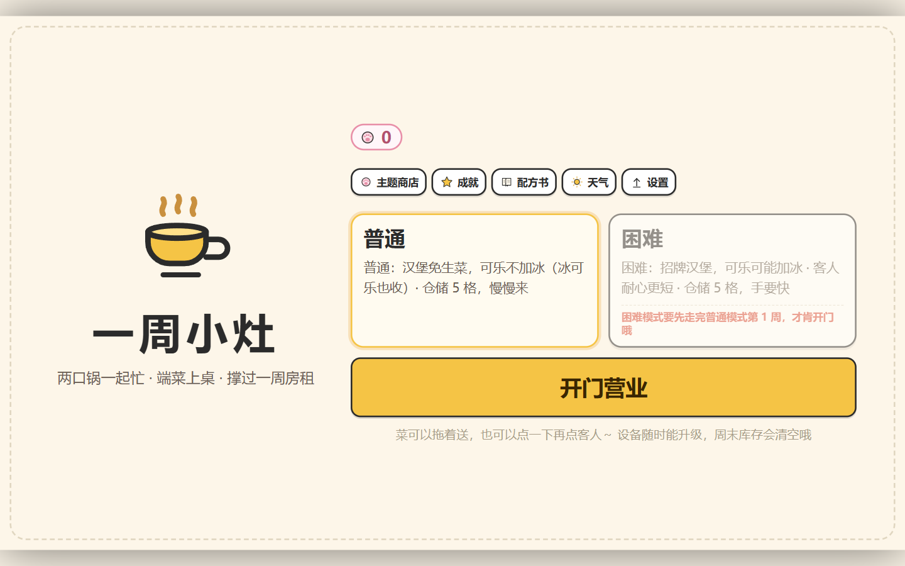
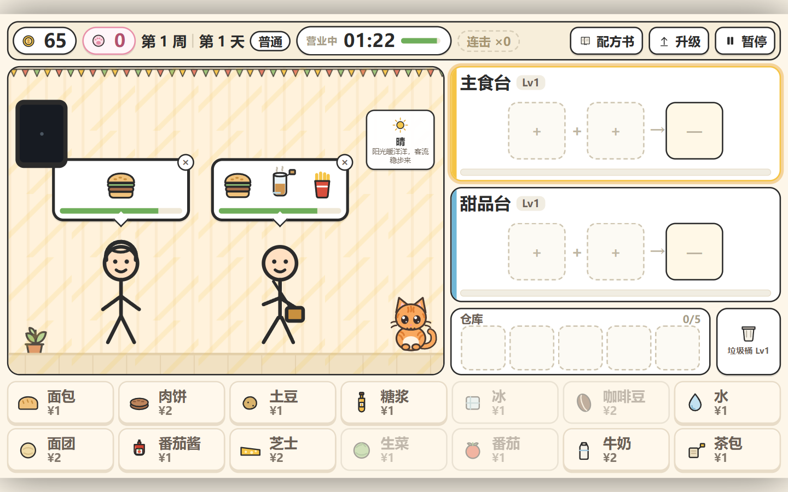
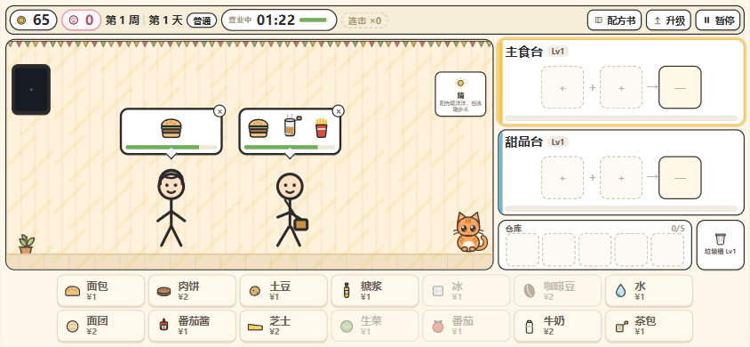
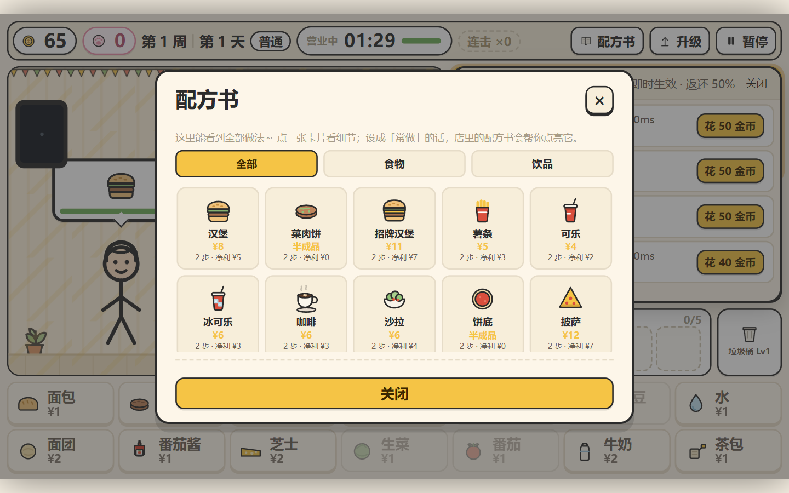

# 食合物语｜Merge Food Story

> 休闲经营 + 手操烹饪的网页小游戏：双工位合成食物与饮品，拖给排队的火柴人顾客，在房租与耐心之间周旋。
> 纯前端 · 零依赖 · 横屏布局 · 可安装 PWA（桌面/Android/iOS）· 断网可玩。
> 店里还养了一只猫：摸摸它会 Q 弹一下，攒猫猫币给它换皮肤。



> 横版界面：左排队区、右双工位、底部仓储与食材区。手机请横屏游玩（竖屏会提示旋转设备，并自动冻结计时）。

## 在线试玩

👉 **https://zhang2026101.github.io/merge-food-story/**

- 桌面 Chrome / Edge：地址栏右侧「安装」→ 独立窗口运行
- Android Chrome：菜单 →「添加到主屏幕」
- iOS Safari：分享 →「添加到主屏幕」（全屏）
- 首次联网加载后，**断网也能启动**（Service Worker 全量缓存）

## 玩法（30 秒上手）

1. 顾客头顶气泡就是订单（食物 + 饮品），气泡边框与底部进度条是耐心；**交付成功的物品会打上绿色对勾并变淡**，一眼看出还差什么。
2. 点食材键 → 自动进入对应工位；两个输入槽都满了就**自动合成**，无序匹配（`糖浆+水` 与 `水+糖浆` 等价）。
3. 成品出现在输出槽 → **拖**到顾客身上（也可点物品再点顾客）。两件都交付即结算：`标价 × 收银台倍率 × (1 + 0.3 × 剩余耐心比例)`，连击另加币。
4. 金币随时可升级炉灶 / 收银台 / 招牌 / 垃圾桶，**即时生效**，并按累计投入的 50% 返还。
5. 撑过 7 天交房租；普通模式残余按标价 30% 回收，困难模式硬报废。
6. 顾客区右下角有只猫 —— 点它会**变矮变宽再回弹**（三帧简笔画），顺手攒猫猫币换皮肤。



手机横屏（844×390）实测：



## 机制清单

| 系统 | 实现 |
|---|---|
| 双工位 | 食物台 / 饮品甜品台各 2 输入 1 输出，互不影响，可并行调度 |
| 合成 | 无序集合匹配（输入顺序无关）；失败品占输出槽、零返还、需丢垃圾桶；读条中不可撤回 |
| 中间产物 | 菜肉饼 / 饼底 → 与成品同库存放，读条 ×0.65；合成完后**直接从输出槽拖回输入格**接着做，或拖进仓库（v2.12 起不再有点按按钮） |
| 饮品线 | 热茶（茶包+水）¥5、冰茶（热茶+冰）¥6、冰淇淋（**牛奶+糖浆**）¥7、奶昔（冰淇淋+牛奶）¥10、咖啡 ¥6、可乐 ¥4、冰可乐 ¥6 |
| 冰 | 冰是**基础材料**，没有「加冰开关」：冰可乐 = 可乐 + 冰，冰茶 = 热茶 + 冰，两步到位、每次只扣增量成本 |
| 仓储 | **统一 5 格**（普通 / 困难相同），食材、半成品、成品都能放，按到货顺序占位；周末清空（普通按售价 25% 回收，半成品回收 0；困难全部报废） |
| 顾客 | 火柴人 6 身 × 6 配饰、VIP（两份同种、×1.8、耐心 ×0.7 —— **比普通客人更短**）、赶客、耐心归零流失 |
| 天气 | **7 种**：晴 / 多云 / 雨 / 雪 / 雾 / 热浪 / 沙尘，每天一种，墙上挂牌显示。改**四件事**：当日客流（雪 6 单最少 ↔ 热浪 10 单最多）、饮品冷热偏好（晴偏冷饮、雪偏热饮）、订单权重（雪热饮 ×1.2）、饮品售价（热浪 +4%）。第 1 天恒晴、交租日只抽晴天/多云/热浪、中间 5 天恶劣天气 ≤ 2 天 |
| 单日循环 | **90 秒营业倒计时**（HUD 实时显示 + 进度条，≤20% 变红）；到店间隔 = 单日时长 / 顾客数（普通 10s、困难 8.2s）；归零即打烊，未处理顾客计流失 |
| 难度 | 普通：汉堡免生菜、可乐不加冰（等价接受冰可乐）；困难：招牌汉堡、可乐 50% 加冰、耐心 ×0.85、队列 4 |
| 小猫 | 顾客区右下角**可爱卡通猫**（大头大眼 + 双高光、ω 嘴、虎斑/奶牛斑），可点击抚摸：三帧（大眼 /「> <」/「^ ^」吐舌）联动 + 变矮变宽的 Q 弹回弹，飘 ♥♪✦ 反馈，280ms 去抖 |
| 猫猫币 | 局外货币（独立存档）：每天营业 **+10**、每周结算**必定 +30**、困难模式全部 ×2；周结算时**每满 25 金币额外 +1 猫猫币，金币不扣除**，单周上限 100（纯白送，不是兑换） |
| 外卖 | 普通模式第 3 天 / 困难第 1 天解锁。手机提前 20 秒亮屏，把餐点拖进手机备好，骑手到达后点「交给骑手」；收益 ×150%，每单 +1 猫猫币（日上限 2）。错过无惩罚 |
| 成就 | 24 个（生存/经营/技巧/挑战/收集），结算时批量判定，达成自动发猫猫币 + toast；主菜单「成就」入口 |
| 皮肤商店 | 主菜单「猫咪商店」，每款 100 猫猫币，即时切换并跨局保存。现有八款：**小橘**（初始）、**奶盖**、**小怪**、**黑猫**、**三花猫**、**蓝猫**、**暹罗猫**、**招财猫**。加一条配置 + 一套配色即可扩展 |
| 体验保障 | 新手引导（可跳过）、判定前撤回输入、暂停冻结、常驻配方书（当日高亮、不遮顾客）、破产软着陆（重开本周保留设备） |



> 📘 完整技术文档（架构 / 系统实现 / 接口清单 / 配置说明 / 状态流转）见 **[PROJECT.md](PROJECT.md)**。

## 本地运行

```bash
git clone https://github.com/zhang2026101/merge-food-story.git
cd merge-food-story
npm run dev        # 零依赖本地服务器 → http://localhost:8080
npm test           # 引擎回归：118 条断言（AC-01~AC-51 数值面 + 合成链 + 猫猫币）
```

> 必须通过 HTTP(S)/localhost 打开；`file://` 会被浏览器拦截 `fetch` 与 Service Worker。

## 结构

```
index.html          入口（manifest / iOS meta / SW 注册）
sw.js               Service Worker，预缓存全部资源，断网可启动
src/config.js       读取 4 个 JSON，构建无序合成表 / 价格成本查询 / i18n / 确定性 RNG
src/engine.js       纯逻辑引擎（无 DOM，可在 Node 直测）
src/view.js         布局 / 拖拽 / 面板 / 教学 / 弹层
src/art.js          简笔画素材（内联 SVG，无渐变/无粒子）+ 卡通小猫三帧 + 皮肤配色表
src/style.css       横版舞台（高 660、宽随视口自适应）与全部界面样式
owk_handoff_*.json  权威数值：经济/难度/节奏/仓储/升级/配方/猫猫币/皮肤/i18n/布局
PROGRESS.md         里程碑与 AC-01~AC-51 逐条验收结论
tools/test-engine.mjs  引擎回归测试
```

## 设计说明

- **数值全部外置**：金币、成本、价格、等级、节奏、仓储都在 `owk_handoff_config.json` / `owk_handoff_crafts.json` 里，改数值不用碰代码。
- **引擎与视图分离**：`engine.js` 不依赖 DOM，所以能在 Node 里跑完整的机制断言（101 条），也可以换成任意渲染层。
- **美术**：全部内联 SVG 简笔画（描边 `#2B2B2B`、纯色填充、禁渐变），没有位图依赖。
- **响应式**：设计高度固定 660 逻辑像素，宽度随视口宽高比在 1120~1551 之间伸缩，所以 16:9 桌面与 19.5:9 / 21:9 横屏手机都满屏且不溢出；资源全部相对路径，可部署在任意子路径下。
- **两层经济**：局内金币（当周清零、会被房租吃掉）与局外猫猫币（永久累积、只用来换皮肤）完全分离，互不干扰存档。

详见 [PROGRESS.md](PROGRESS.md)（含实现假设：耐心基准值的补齐、冰淇淋从材料改成品后的成本重算、小猫形变为何用「帧 + CSS 变换」两段实现等）。

---

MIT License · 音乐/美术均为代码绘制，无第三方素材
